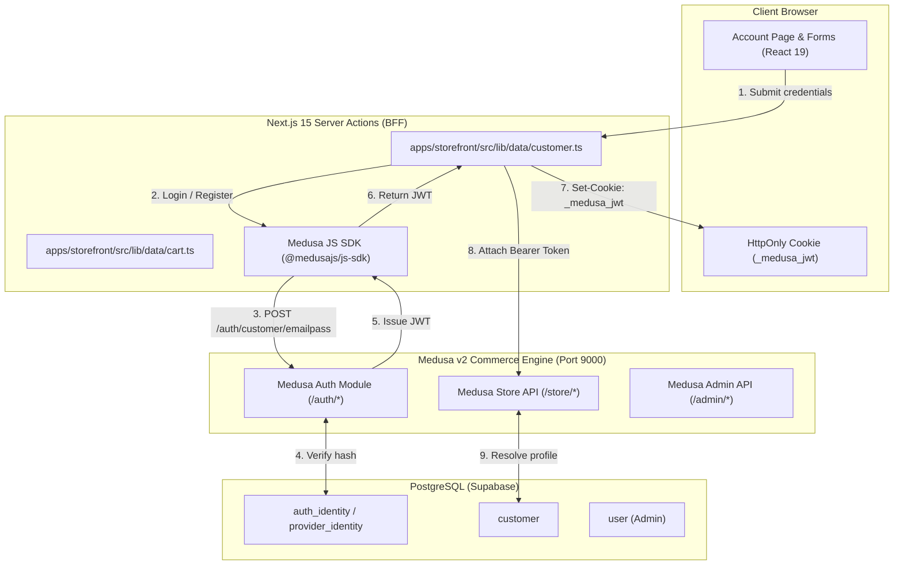
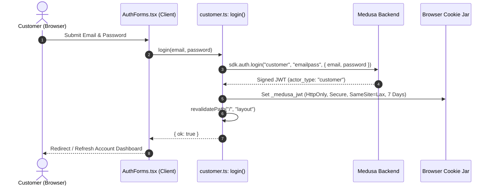
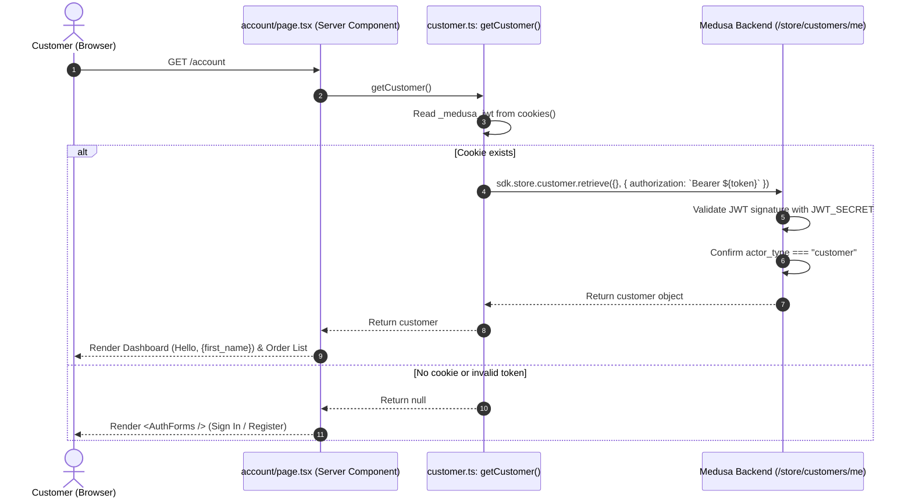
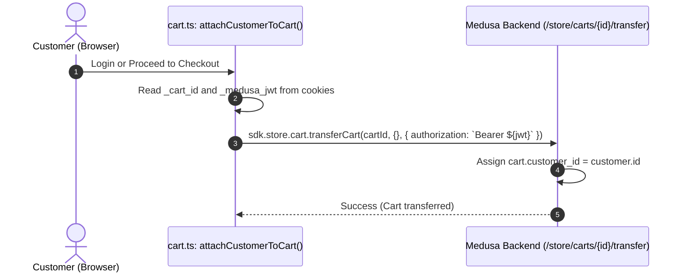
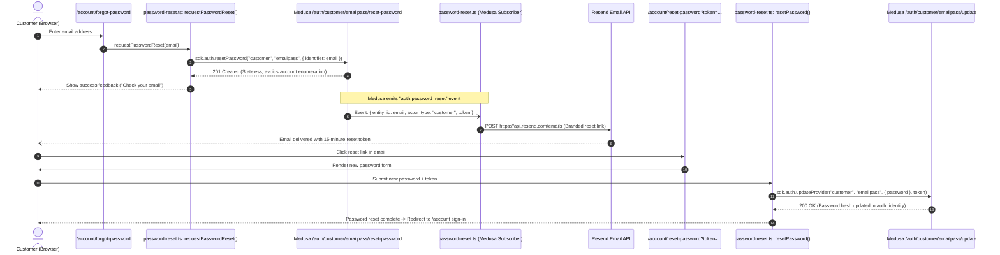
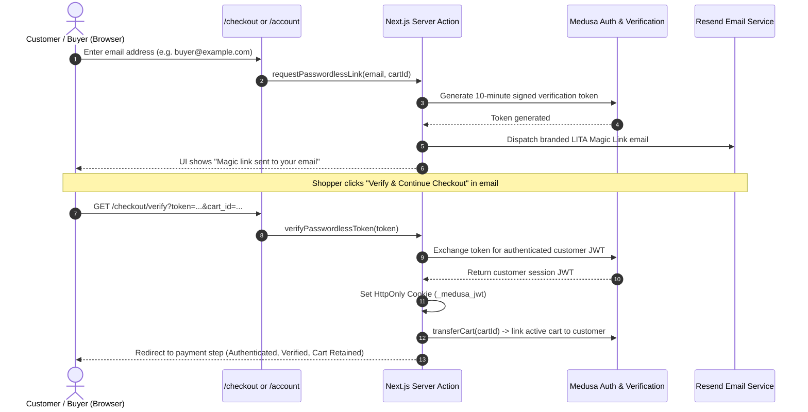

# LITA Authentication & Authorization Technical Specification

This document details the complete technical architecture, lifecycle flows, security guarantees, and implementation code for authentication and authorization across the **LITA** (*Livin In The Art*) monorepo.

---

## 1. Architecture Overview

LITA utilizes **Medusa v2's Auth Module** coupled with **Next.js 15 App Router Server Actions** and **HTTP-only cookies**:

- **Backend**: Medusa v2 commerce engine running on Node.js/Express, persisting authentication identities in PostgreSQL (Supabase).
- **Storefront**: Next.js 15 (`@medusajs/js-sdk`) utilizing Server Actions for token exchange and SSR page protection.
- **Protocol**: Stateless JSON Web Tokens (JWT) issued by Medusa, transported in secure HTTP-only cookies and injected as `Authorization: Bearer <token>` headers.



---

## 2. Core Concept: Medusa v2 Actor-Based Auth Model

Medusa v2 strictly decouples **Authentication Identities** from **Domain Actors**:

| Concept | Description | Database Entity | Scope |
| :--- | :--- | :--- | :--- |
| **`auth_identity`** | Stores authentication credentials (provider: `emailpass`, hashed password). | `auth_identity` | Global authentication record |
| **`actor_id`** | The specific domain entity ID linked to this auth identity. | `customer.id` or `user.id` | Domain specific |
| **`actor_type`** | The role boundary (`customer` vs `user`). | `auth_identity.app_metadata` | Access control boundary |

### Role Boundaries
- **`customer`**: Storefront shoppers. Can only access `/store/customers/me`, own carts, and personal order history. Tokens with `actor_type: customer` are rejected if presented to `/admin/*`.
- **`user`**: Store administrators. Authenticate via `/auth/user/emailpass` and manage the store via `/admin/*`.

---

## 3. End-to-End Authentication Flows

### A. Customer Registration Flow (Two-Phase Identity Binding)

Because authentication is decoupled from the customer domain record, Medusa v2 performs registration in two linked phases:

```mermaid
sequenceDiagram
    autonumber
    actor User as Customer (Browser)
    participant ServerAction as customer.ts (Server Action)
    participant MedusaAuth as Medusa /auth/customer/emailpass
    participant MedusaStore as Medusa /store/customers
    participant DB as PostgreSQL

    User->>ServerAction: register({ email, password, first_name, last_name })
    Note over ServerAction,MedusaAuth: Phase 1: Create Auth Identity
    ServerAction->>MedusaAuth: sdk.auth.register("customer", "emailpass", { email, password })
    MedusaAuth->>DB: INSERT into auth_identity (email, password_hash)
    MedusaAuth-->>ServerAction: Returns temporary registration token (regToken)

    Note over ServerAction,MedusaStore: Phase 2: Create Customer & Bind Identity
    ServerAction->>MedusaStore: sdk.store.customer.create(data, {}, { auth: Bearer regToken })
    MedusaStore->>DB: INSERT into customer; link customer_id to auth_identity
    MedusaStore-->>ServerAction: Customer profile created

    Note over ServerAction,User: Phase 3: Auto-Login
    ServerAction->>MedusaAuth: sdk.auth.login("customer", "emailpass", { email, password })
    MedusaAuth-->>ServerAction: Final Session JWT
    ServerAction-->>User: Set HttpOnly Cookie (_medusa_jwt)
```

---

### B. Customer Login & Session Establishment Flow



---

### C. Authenticated Request & Authorization Flow



---

### D. Guest Cart to Customer Cart Linking Flow

When a guest adds items to a cart, a `_cart_id` cookie is assigned. Upon login or checkout, the guest cart is linked to the authenticated customer:



---

### E. Customer Password Reset Flow (via Resend)

Password reset is executed via Medusa v2's event-driven workflow coupled with Resend email delivery:




---

## 4. Source Code Implementations & Snippets

### A. Storefront Authentication Service
Located at `apps/storefront/src/lib/data/customer.ts`:

```typescript
"use server";

import { cookies } from "next/headers";
import { revalidatePath } from "next/cache";
import type { HttpTypes } from "@medusajs/types";
import { sdk } from "@/lib/medusa";

const JWT_COOKIE = "_medusa_jwt";

export type AuthResult = { ok: true } | { ok: false; error: string };

/** Extract Authorization Bearer header from secure cookie */
export async function getAuthHeaders(): Promise<{ authorization?: string }> {
  const token = (await cookies()).get(JWT_COOKIE)?.value;
  return token ? { authorization: `Bearer ${token}` } : {};
}

/** Store JWT in HTTP-Only, Secure, Lax Cookie */
async function storeToken(token: string) {
  (await cookies()).set(JWT_COOKIE, token, {
    maxAge: 60 * 60 * 24 * 7, // 7 days expiration
    httpOnly: true,            // Inaccessible to browser JavaScript (XSS mitigation)
    sameSite: "lax",           // CSRF mitigation
    secure: process.env.NODE_ENV === "production",
    path: "/",
  });
}

/** Retrieve current authenticated customer */
export async function getCustomer(): Promise<HttpTypes.StoreCustomer | null> {
  const headers = await getAuthHeaders();
  if (!headers.authorization) return null;
  try {
    const { customer } = await sdk.store.customer.retrieve({}, headers);
    return customer;
  } catch {
    return null;
  }
}

/** Sign in customer with email and password */
export async function login(email: string, password: string): Promise<AuthResult> {
  try {
    const token = await sdk.auth.login("customer", "emailpass", { email, password });
    if (typeof token !== "string") {
      return { ok: false, error: "This sign-in method isn't supported here." };
    }
    await storeToken(token);
    revalidatePath("/", "layout");
    return { ok: true };
  } catch {
    return { ok: false, error: "Email or password is incorrect." };
  }
}

/** Register new customer and bind auth identity */
export async function register(input: {
  email: string;
  password: string;
  first_name: string;
  last_name: string;
}): Promise<AuthResult> {
  try {
    // 1. Create auth identity
    const regToken = await sdk.auth.register("customer", "emailpass", {
      email: input.email,
      password: input.password,
    });
    if (typeof regToken !== "string") {
      return { ok: false, error: "We couldn't create the account. Try again." };
    }
    // 2. Create customer entity bound to this auth identity
    await sdk.store.customer.create(
      {
        email: input.email,
        first_name: input.first_name,
        last_name: input.last_name,
      },
      {},
      { authorization: `Bearer ${regToken}` }
    );
    // 3. Complete login
    return login(input.email, input.password);
  } catch (e) {
    const msg = e instanceof Error ? e.message : "";
    if (/exists/i.test(msg)) {
      return { ok: false, error: "An account with this email already exists. Sign in instead." };
    }
    return { ok: false, error: "We couldn't create the account. Try again." };
  }
}

/** Sign out customer and purge session cookie */
export async function logout(): Promise<void> {
  (await cookies()).delete(JWT_COOKIE);
  revalidatePath("/", "layout");
}
```

---

### B. Medusa JS SDK Client Initialization
Located at `apps/storefront/src/lib/medusa.ts`:

```typescript
import Medusa from "@medusajs/js-sdk";

export const sdk = new Medusa({
  baseUrl: process.env.NEXT_PUBLIC_MEDUSA_BACKEND_URL || "http://localhost:9000",
  publishableKey: process.env.NEXT_PUBLIC_MEDUSA_PUBLISHABLE_KEY,
});
```

---

### C. Server-Side Page Route Guard
Located at `apps/storefront/src/app/account/page.tsx`:

```tsx
import type { Metadata } from "next";
import { getCustomer, listOrders } from "@/lib/data/customer";
import { AuthForms } from "@/components/AuthForms";
import { LogoutButton } from "@/components/LogoutButton";

export const dynamic = "force-dynamic";

export default async function AccountPage() {
  const customer = await getCustomer();

  // If unauthenticated: render Login / Registration Forms
  if (!customer) {
    return (
      <div className="page py-12">
        <h1 className="mb-8 text-3xl">Account</h1>
        <AuthForms />
      </div>
    );
  }

  // If authenticated: render Profile and Order History
  const orders = await listOrders();
  return (
    <div className="page py-12">
      <div className="mb-10 flex items-center justify-between">
        <h1 className="text-3xl">Hello, {customer.first_name || customer.email}</h1>
        <LogoutButton />
      </div>
      {/* Order List Display */}
    </div>
  );
}
```

---

### D. Backend Configuration
Located at `apps/backend/medusa-config.ts`:

```typescript
import { loadEnv, defineConfig } from '@medusajs/framework/utils'

loadEnv(process.env.NODE_ENV || 'development', process.cwd())

module.exports = defineConfig({
  projectConfig: {
    databaseUrl: process.env.DATABASE_URL,
    databaseDriverOptions: process.env.DATABASE_EXTRA
      ? JSON.parse(process.env.DATABASE_EXTRA)
      : undefined,
    http: {
      storeCors: process.env.STORE_CORS!,
      adminCors: process.env.ADMIN_CORS!,
      authCors: process.env.AUTH_CORS!,
      jwtSecret: process.env.JWT_SECRET,        // Secret used to sign customer and user JWTs
      cookieSecret: process.env.COOKIE_SECRET,  // Secret used for signed cookies
    }
  }
})
```

---

## 5. Security & Authorization Guarantees

| Vulnerability / Concern | Mitigation in LITA |
| :--- | :--- |
| **XSS (Cross-Site Scripting)** | JWT tokens are stored exclusively in **`HttpOnly`** cookies. JavaScript running in the browser cannot read `document.cookie` to exfiltrate the token. |
| **CSRF (Cross-Site Request Forgery)** | Cookies are configured with **`SameSite: "lax"`**. Browser will not send cookies on cross-origin mutation requests. |
| **Tampering & Forgery** | All JWT tokens are signed using the backend `JWT_SECRET`. Unauthorized modifications invalidate cryptographic signature. |
| **Privilege Escalation** | Medusa strictly validates `actor_type` per endpoint. A customer JWT cannot be used to invoke `/admin/*` operations. |
| **Catalog Scoping** | `NEXT_PUBLIC_MEDUSA_PUBLISHABLE_KEY` scopes all product and pricing access to the designated LITA sales channel. |
| **Account Enumeration** | `requestPasswordReset` always returns HTTP 201 without indicating whether an email identity exists in the database. |
| **Token Expiration** | Password reset tokens expire in 15 minutes (`900s`); session JWTs expire in 7 days (`JWT_EXPIRES_IN=7d`), aligned with the browser cookie `maxAge`. |
| **Secrets & CORS Enforcement** | Production fail-fast guard crashes during startup if `JWT_SECRET`/`COOKIE_SECRET` are missing or < 32 chars, or if CORS variables contain unsafe wildcards. |
| **Brute Force / Rate Limiting** | Handled at Edge / Reverse Proxy infrastructure layer (Cloudflare WAF / Vercel rate-limit / Upstash Redis sliding window). |

---

## 6. Summary Comparison Matrix

| Feature | Customer Auth (Storefront) | Admin Auth (Dashboard) |
| :--- | :--- | :--- |
| **Actor Type** | `customer` | `user` |
| **Login Endpoint** | `/auth/customer/emailpass` | `/auth/user/emailpass` |
| **Self-Registration** | Allowed (`/auth/customer/emailpass/register`) | Restricted (Admin invite workflow) |
| **Session Medium** | `_medusa_jwt` HttpOnly cookie | Admin session cookie / Bearer token |
| **Accessible APIs** | `/store/*` | `/admin/*` + `/store/*` |
| **UI Location** | `/account` | `/app` |

---

## 7. Rate Limiting Strategy (Postponed to Infrastructure Layer)

In a decoupled architecture (Next.js 15 App Router Server Actions + Medusa v2 Node backend), code-level in-memory rate limiting is fragile because:
1. In-memory state resets whenever server instances or serverless functions recycle.
2. Next.js Server Actions execute on the server BFF layer and bypass typical edge middleware route matchers unless explicitly routed.
3. Multi-instance container or cluster deployments cannot share in-memory state without an external data store.

### Recommended Production Implementations:
1. **Cloudflare WAF Rate Limiting (Recommended):**
   - Apply rate limiting rules directly on `/auth/*` and `/account` endpoints.
   - Example rule: Max 10 requests per minute per IP on `/auth/customer/emailpass` and `/auth/customer/emailpass/reset-password`.
   - Protects the origin backend from traffic floods before requests reach Node.js.
2. **Upstash Redis Distributed Sliding Window:**
   - Utilizing `@upstash/ratelimit` within Next.js `middleware.ts` or route handlers.
   - Requires `UPSTASH_REDIS_REST_URL` and `UPSTASH_REDIS_REST_TOKEN`.

---

## 8. Selected Email Verification Strategy: Option C (Passwordless / Magic Link at Checkout)

Following architecture review, **Option C** was chosen as the primary email verification and low-friction authentication paradigm for LITA.

### Rationale
In high-end editorial and fine art commerce, requiring prospective buyers to create or remember passwords during checkout introduces critical cart abandonment friction. Option C seamlessly verifies the customer's email address while establishing an authenticated session in a single gesture.

### Workflow & Architecture Diagram



### Key Security & UX Guarantees
1. **Single-Use Signed Tokens:** Magic link tokens are cryptographically signed with the backend `JWT_SECRET`, valid for 10 minutes, and invalidated immediately upon first redemption.
2. **Seamless Cart Preservation:** Any items previously placed in the guest cart are atomically linked to the newly resolved or verified customer via Medusa's `transferCart`.
3. **Dual Compatibility:** Returning customers who prefer conventional password login retain standard `/auth/customer/emailpass` capabilities without collision.

