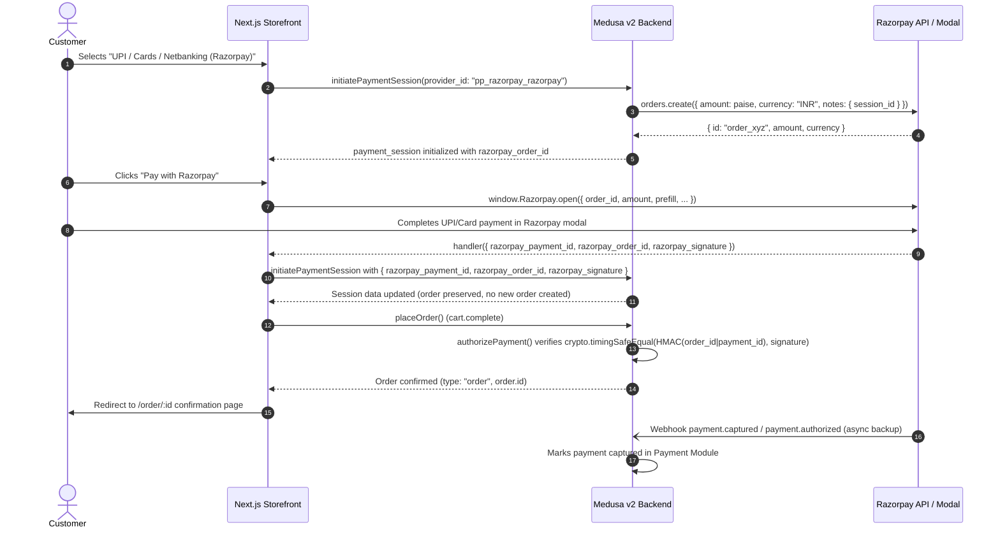

# Razorpay Payment Integration Guide

This document describes the Razorpay payment integration for **Livin In The Art (LITA)** across Medusa v2 (`@dtc/backend`) and the Next.js Storefront (`@dtc/storefront`).

---

## 1. Overview

- **Provider Identifier:** `pp_razorpay_razorpay`
- **Supported Payment Methods:** UPI (Google Pay, PhonePe, Paytm, BHIM), Credit/Debit Cards, Netbanking, Wallets
- **Default Currency:** INR (Indian Rupee, ₹)
- **Math & Precision:** Medusa calculates prices in major units (₹499.00). Razorpay requires amounts in paise (₹499.00 = 49900 paise). All conversions are handled automatically in `src/modules/razorpay/service.ts`.
- **Order Lifecycle:** Orders are created only after HMAC signature verification passes.

---

## 2. Environment Variables

### Backend (`apps/backend/.env`)

```env
# Razorpay API Credentials (from Razorpay Dashboard > Account & Settings > API Keys)
RAZORPAY_KEY_ID=rzp_test_xxx
RAZORPAY_KEY_SECRET=xxx

# Razorpay Webhook Secret (configured in Razorpay Dashboard > Settings > Webhooks)
RAZORPAY_WEBHOOK_SECRET=xxx
```

### Storefront (`apps/storefront/.env.local`)

```env
# Public Key ID for Razorpay Checkout modal (NEVER put the Key Secret here)
NEXT_PUBLIC_RAZORPAY_KEY_ID=rzp_test_xxx
NEXT_PUBLIC_DEFAULT_REGION=in
```

---

## 3. Webhook Configuration

1. In the Razorpay Dashboard (Test or Live mode):
   Navigate to **Settings** -> **Webhooks** -> **Add New Webhook**.
2. **Webhook URL:**
   ```
   https://<your-backend-domain>/hooks/payment/razorpay_razorpay
   ```
   *For local development, use an ngrok or Cloudflare tunnel URL, e.g.:*
   `https://xyz.ngrok-free.app/hooks/payment/razorpay_razorpay`
3. **Secret:** Set a strong secret string and add it to `RAZORPAY_WEBHOOK_SECRET` in `apps/backend/.env`.
4. **Active Events:**
   - `payment.authorized`
   - `payment.captured`
   - `payment.failed`

Medusa v2 automatically preserves the raw request body on `/hooks/payment/*` and routes the webhook to `RazorpayProviderService.getWebhookActionAndData`, which verifies the HMAC SHA-256 signature using `x-razorpay-signature`.

---

## 4. End-to-End Payment Flow



---

## 5. Testing Guide

### Automated Tests

Run the dedicated Razorpay unit test suite:

```bash
cd apps/backend
npm run test:razorpay
```

This verifies:
- `toPaise` & `fromPaise` precision across whole and fractional rupee amounts
- `validateOptions` credential checking
- HMAC SHA-256 signature verification (valid vs tampered signatures)
- Idempotency & cart update order preservation
- Webhook signature validation and event mapping (`payment.authorized`, `payment.captured`, `payment.failed`)

### Manual Checkout Test in Test Mode

1. Start backend and storefront:
   ```bash
   npm run dev
   ```
2. In Medusa Admin (`http://localhost:9000/app`):
   - Navigate to **Settings** -> **Regions** -> **India** (or default region).
   - Ensure **INR** is enabled as a currency.
   - Under **Payment Providers**, verify **Razorpay** (`pp_razorpay_razorpay`) is enabled.
3. In Storefront (`http://localhost:8000`):
   - Add any product/artwork to bag.
   - Proceed to checkout, fill in shipping address.
   - Under Payment, select **"UPI / Cards / Netbanking (Razorpay)"**.
   - Click **"Continue to review"**, then click **"Pay with Razorpay"**.
   - In Razorpay test modal:
     - **UPI test:** Enter `success@razorpay` to simulate an immediate successful UPI payment.
     - **Card test:** Use Razorpay test card `4111 1111 1111 1111`, any future expiry, OTP `123456`.
     - **Failure test:** Enter `failure@razorpay` to verify error handling without corrupting the cart.
4. Verify the order created in Medusa Admin shows the correct INR total, status `captured`/`authorized`, and references the `razorpay_payment_id`.

---

## 6. Go-Live Checklist

- [ ] Complete Razorpay business KYC and activate Live mode in Razorpay Dashboard.
- [ ] Generate Live Mode API Keys (`rzp_live_...`) in Razorpay Dashboard.
- [ ] Add `RAZORPAY_KEY_ID`, `RAZORPAY_KEY_SECRET`, and `RAZORPAY_WEBHOOK_SECRET` to production environment variables (e.g. Railway/Render/AWS/Vercel).
- [ ] Add `NEXT_PUBLIC_RAZORPAY_KEY_ID` to production storefront environment variables. Confirm `RAZORPAY_KEY_SECRET` is NEVER exposed to the frontend bundle.
- [ ] Create a Live Webhook in Razorpay Dashboard pointing to `https://<production-backend-domain>/hooks/payment/razorpay_razorpay` with its own secret.
- [ ] Verify `STORE_CORS` on the backend includes the production storefront URL with HTTPS.
- [ ] Verify Razorpay compliance requirements on storefront:
  - Terms of Service
  - Privacy Policy
  - Return / Refund Policy
  - Contact Us page with business details
- [ ] Perform a small live test payment (e.g. ₹1) and process a refund from Medusa Admin.
